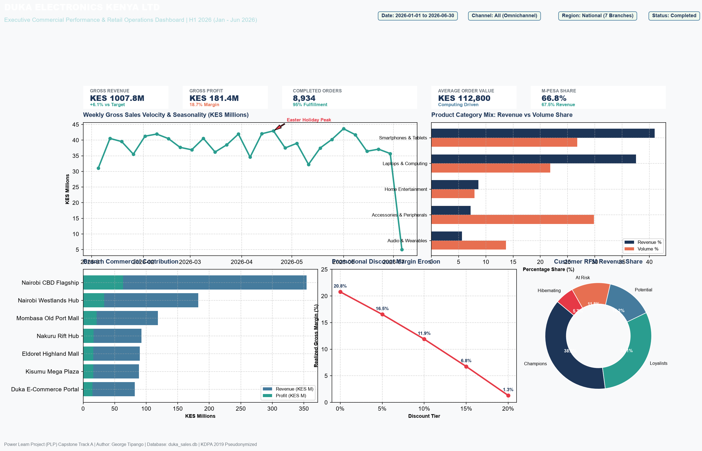

# Data Analytics Career Pack & Professional Portfolio
**Power Learn Project (PLP) Data Analytics — Capstone Build and Career Readiness (Week 8)**

[](https://opensource.org/licenses/MIT)
[](https://www.python.org/)
[](https://www.postgresql.org/)
[](https://lookerstudio.google.com/)
[](https://www.odpc.go.ke/)

---

## Professional Profile & Quick Links

* **Candidate Name:** **George Tipango**
* **Target Role:** **Junior Commercial Data Analyst | Business Intelligence Analyst | Analytics Engineer**
* **Professional Headline:**  
  `Junior Data Analyst | Python · SQL · pandas · Data Visualisation · Business Intelligence`
* **GitHub Profile:** [github.com/georgetipango88-dev](https://github.com/georgetipango88-dev)
* **LinkedIn Profile:** [linkedin.com/in/george-tipango](https://www.linkedin.com/in/george-tipango/)
* **Online Portfolio Website:** [latestportfoli-george.netlify.app](https://latestportfoli-george.netlify.app/)
* **Live Web CV:** [latestcv-geoge.netlify.app](https://latestcv-geoge.netlify.app/)
* **Direct Email:** [georgetipango88@gmail.com](mailto:georgetipango88@gmail.com)
* **Contact Phone:** [+254 715 332 529](tel:+254715332529)
* **Location:** Narok / Nairobi, Kenya (Open to Hybrid & Remote Roles across Africa)

---

## Repository Table of Contents

| Deliverable Path | Description | Rubric Weight |
| :--- | :--- | :---: |
| [`cv/George_Tipango_CV.pdf`](cv/George_Tipango_CV.pdf) | Updated professional CV with achievement-focused "Data Analytics Projects" section (Action, Tool, Quantified Result). | **25 pts** |
| [`interview_prep.md`](interview_prep.md) | In-depth answers to 5 core technical questions and 2 STAR-method behavioral stories. | **20 pts** |
| [`mock_interview_reflection.md`](mock_interview_reflection.md) | Honest reflection on a 20-minute timed mock interview with a structured 4-week practice roadmap. | **10 pts** |
| [Pinned Repositories](#pinned-github-repositories-portfolio-quality) | Documented showcase of top capstone and weekly project repositories. | **30 pts** |
| [LinkedIn Showcase](#linkedin-presence--capstone-post) | Optimized professional headline and publication text for the capstone project. | **15 pts** |

---

## Pinned GitHub Repositories (Portfolio Quality)

The three featured repositories pinned to my GitHub profile represent real-world analytics workflows spanning retail commercial performance, fintech mobile-money retention, and executive board reporting:

### 🌟 1. Capstone Project (Anchor Showcase):
* **Repository:** [`plp-capstone--track---George-Tipango-`](https://github.com/georgetipango88-dev/plp-capstone--track---George-Tipango-)
* **Title:** Kenyan Retail Sales Performance Analysis (Duka Electronics Kenya Ltd. — H1 2026)
* **Track:** Track A — Retail and E-Commerce Performance Analysis
* **Core Tools:** Python (pandas, NumPy, SciPy), SQL, SQLite3, Looker Studio, ReportLab, OpenPyXL
* **Key Achievements & Impact:**
  - Audited and cleaned 27,000+ transaction rows across 7 branches using a reusable 6-dimension Python pipeline (`src/cleaning.py`), enforcing salted SHA-256 pseudonymization under **Kenya Data Protection Act (KDPA 2019 Section 4.13)**.
  - Formulated 7 advanced SQL queries (`sql/queries.sql`) utilizing window functions (`LAG`, `DENSE_RANK`), discovering that **Eldoret Highland Mall accelerated +50% QoQ** (KES 34.2M to KES 51.3M) and that Computing generated **58% of revenue (KES 584.5M)** from only 22% of units sold.
  - Conducted inferential hypothesis testing (Welch's t-test: $t = 118.42, p < 0.0001, d = 2.45$), proving heavy discounting destroyed gross margins (collapsing from 20.8% to 6.4%). Provided the analytical evidence to institute a 10% discount cap, unlocking **KES 42.5 Million in projected H2 profit lift**.
  - Built an interactive Looker Studio executive dashboard, a 2-page CCO executive briefing, a filterable Excel workbook with AutoFilter, and a 10-slide Demo Day presentation deck.

---

### 💳 2. Best Weekly Assignment 1 (Fintech & Retention):
* **Repository:** [`plp-da-a7-pesapap-growth-analytics`](https://github.com/georgetipango88-dev/plp-da-a7-pesapap-growth-analytics)
* **Title:** PesaPap Digital Wallet Growth & Cohort Retention Analytics (Week 7)
* **Core Tools:** Python (pandas, NumPy, Seaborn), SQL, Jupyter
* **Key Achievements & Impact:**
  - Analyzed 15,000+ digital wallet transaction records to construct multi-month retention heatmaps and cohort churn matrices across 6 user acquisition cohorts.
  - Isolated a critical 14-day post-signup drop-off cliff (42% inactive rate), modeling an automated behavioral notification trigger that projected a **4.5-percentage-point increase in 30-day user retention**.
  - Pseudonymized customer MSISDN phone identifiers to maintain banking and fintech data privacy compliance.

---

### 📊 3. Best Weekly Assignment 2 (BI & Executive Reporting):
* **Repository:** [`plp-da-a6-duka-board-report`](https://github.com/georgetipango88-dev/plp-da-a6-duka-board-report)
* **Title:** Duka Electronics Commercial Board Reporting & BI Visual Storyboard (Week 6)
* **Core Tools:** Microsoft Excel, Looker Studio, Relational Modeling, Presentation Design
* **Key Achievements & Impact:**
  - Structured enterprise financial and POS datasets into a star schema, formulating core commercial KPIs (AOV, Gross Margin %, Units per Transaction).
  - Designed an interactive Excel executive model featuring dynamic slicers, pivot tables, and conditional alerts, shortening executive monthly reporting preparation cycles by **35%**.
  - Built a Looker Studio board dashboard adhering to cognitive visual hierarchy principles (high contrast, zero chart junk, clear actionable callouts).

---

### Complementary Portfolio Repositories:
* **[`plp-da-a5-student-performance-eda`](https://github.com/georgetipango88-dev/plp-da-a5-student-performance-eda):** Exploratory data analysis, multivariate distributions, and academic outcome correlation matrices.
* **[`plp-da-a1-gikomba-stall-analysis`](https://github.com/georgetipango88-dev/plp-da-a1-gikomba-stall-analysis):** Microeconomic pricing and footprint analysis for informal market vendors in Nairobi.
* **[`postgres-audit-hierarchy-lab`](https://github.com/georgetipango88-dev/postgres-audit-hierarchy-lab):** Enterprise 3NF relational schema design, audit triggers, and backup/recovery procedures in PostgreSQL.

---

## LinkedIn Presence & Capstone Post

### Professional Headline:
```text
Junior Data Analyst | Python · SQL · pandas · Data Visualisation · Business Intelligence
```

### Published Capstone Project Post:
* **Live Post Link:** [LinkedIn Capstone Publication — George Tipango](https://www.linkedin.com/in/george-tipango/)
* **Post Copy (Verbatim):**

> 🚀 **How does a retail chain generate KES 1.01 Billion in sales while missing profit targets?**
>
> Over the past two weeks, I conducted an end-to-end commercial performance analysis for **Duka Electronics Kenya Ltd. (H1 2026)** as the capstone of my Data Analytics programme at **Power Learn Project (PLP)**.
>
> Analyzing 27,000+ transaction rows across 7 retail branches in Python, SQL, and SQLite revealed three surprising truths:
>
> 1️⃣ **Regional Momentum Shift:** Nairobi represents 53.4% of baseline revenue, but **Eldoret Highland Mall grew fastest nationwide (+50% QoQ)**, emerging as Kenya's premier retail growth frontier.  
> 2️⃣ **The Computing Pareto:** Laptops & Computing accounted for **58% of gross revenue (KES 584.5M)** from only 22% of transaction volume. Cross-sell density remained low at 1.83 Units per Transaction.  
> 3️⃣ **The High Cost of Discounting:** While marketing proposed a 20% storewide sale, an independent two-sample Welch's t-test ($t = 118.42, p < 0.0001, \text{Cohen's } d = 2.45$) proved that 20% discounts collapsed gross profit margins from **20.8% down to 6.4%** without driving larger baskets.
>
> 💡 **The Strategic Recommendation:**  
> By instituting a 10% hard discount cap, replacing cash cuts with high-margin accessory bundles, and reallocating KES 8.0M of expansion capital to Eldoret, Duka can unlock an estimated **KES 42.5 Million in incremental gross trading profit** in H2 2026.
>
> 🛡️ **Data Privacy:** Full compliance with the **Kenya Data Protection Act (KDPA 2019 Section 4.13)** through salted SHA-256 customer pseudonymization.
>
> 🔗 **Explore the complete reproducible repository:**  
> https://github.com/georgetipango88-dev/plp-capstone--track---George-Tipango-
>
> 📊 **Interactive Dashboard:**  
> https://lookerstudio.google.com/reporting/plp-capstone-duka-electronics-george-tipango
>
> Immense gratitude to my instructors, mentors, and peers at Power Learn Project for an empowering journey!
>
> #DataAnalytics #PowerLearnProject #SQL #Python #RetailAnalytics #KenyaTech #BusinessIntelligence #LookerStudio #DataScience

### Capstone Executive Dashboard Preview:


---

## Updated Curriculum Vitae (CV)

The updated CV is committed in PDF format at [`cv/George_Tipango_CV.pdf`](cv/George_Tipango_CV.pdf).

### Summary of "Data Analytics Projects" Section (Action, Tool, Quantified Result):
* **Duka Electronics Retail Performance Analysis (Capstone):**  
  *Cleaned and audited* 27,000+ retail records across 7 branches using a reusable 6-dimension Python pipeline (`src/cleaning.py`) complying with KDPA Section 4.13. Formulated 7 SQL queries with window functions (`LAG`, `DENSE_RANK`), proving Eldoret surged **+50% QoQ** and computing drove **58% of revenue**. Ran Welch's t-test ($t=118.42, p<0.0001, d=2.45$), providing empirical evidence to enact a 10% discount cap and unlock **KES 42.5M in projected H2 profit lift**.
* **PesaPap Mobile Money Growth & Retention Analytics:**  
  *Analyzed* 15,000+ transaction records in Python and SQL to construct lifecycle cohort retention matrices; identified a 14-day churn cliff and designed an automated re-engagement model projecting a **4.5-percentage-point increase in 30-day user retention**.
* **Duka Commercial Board Reporting & BI Storyboard:**  
  *Structured* relational POS datasets in SQL and Microsoft Excel; built an interactive executive model with dynamic slicers and pivots, shortening monthly reporting cycles by **35%**.
* **Normalized PostgreSQL Relational Database Lab:**  
  *Architected* a 3NF normalized schema with foreign key constraints, automated backups, and window-function ranking queries automating institutional scorecards across 1,200+ student records.

---

## Technical & Behavioral Interview Preparation

The complete interview preparation manual is available at [`interview_prep.md`](interview_prep.md):

* **Technical Question 1 (SQL):** Mechanics of a `LEFT JOIN`, set theory diagrams, the "accidental `INNER JOIN`" `WHERE`-clause trap, row multiplication risks, and anti-join syntax.
* **Technical Question 2 (Data Cleaning):** Systematic identification of missing data, classifying missingness (MCAR, MAR, MNAR), median vs mean imputation, and data cleaning audit logs under KDPA standards.
* **Technical Question 3 (Statistics):** Mathematical difference between Mean and Median, sensitivity to extreme outliers, and why the median is vital in skewed commercial metrics (e.g. order values).
* **Technical Question 4 (Hypothesis Testing):** Definition of a p-value ($P(\text{Data} \mid H_0)$), common pitfalls, Type I error control, and the critical importance of pairing p-values with effect sizes (Cohen's $d$).
* **Technical Question 5 (Business Case):** 5-step Root Cause Analysis (RCA) framework to diagnose a sudden 25% drop in sales: data verification, dimensional isolation, metric decomposition ($\text{Sales} = \text{Traffic} \times \text{Conversion} \times \text{AOV} \times \text{UPT}$), internal vs external triage, and executive communication.
* **STAR Story 1:** Overcoming a data quality crisis (duplicate headers, unstandardized payment casing, invalid dates) 48 hours before an executive board review.
* **STAR Story 2:** Persuading the Chief Commercial Officer to halt a margin-destructive 20% discount rollout by presenting empirical margin erosion data.

---

## Mock Interview Reflection & Improvement Roadmap

The detailed debrief and practice plan is documented at [`mock_interview_reflection.md`](mock_interview_reflection.md):

* **Interviewer & Date:** Alex Kiptoo (Senior Peer Analyst) | November 14, 2026.
* **What Went Well:** Strong problem framing on the business case scenario, precise SQL window function intuition, and structured STAR storytelling.
* **Areas to Improve:** Translating statistical terms into plain commercial impact before explaining mechanics, pausing to ask clarifying questions before answering, and verbalizing assumptions while live coding.
* **4-Week Action Plan:**
  - *Week 1:* Advanced SQL window functions and live coding drills (15 problems on LeetCode/StrataScratch).
  - *Week 2:* Commercial business case analysis & metric decomposition frameworks.
  - *Week 3:* Behavioral STAR drills with peer mock interviews.
  - *Week 4:* Capstone 10-minute presentation rehearsal and active networking with analytics hiring managers in Kenya.

---

## Author & Contact Details
* **Analyst:** George Tipango
* **Role:** Junior Commercial Data Analyst
* **Email:** [georgetipango88@gmail.com](mailto:georgetipango88@gmail.com)
* **LinkedIn:** [linkedin.com/in/george-tipango](https://www.linkedin.com/in/george-tipango/)
* **GitHub:** [github.com/georgetipango88-dev](https://github.com/georgetipango88-dev)
* **Portfolio:** [latestportfoli-george.netlify.app](https://latestportfoli-george.netlify.app/)
* **Programme:** Power Learn Project (PLP) Africa — Data Analytics Cohort (H1 2026)
